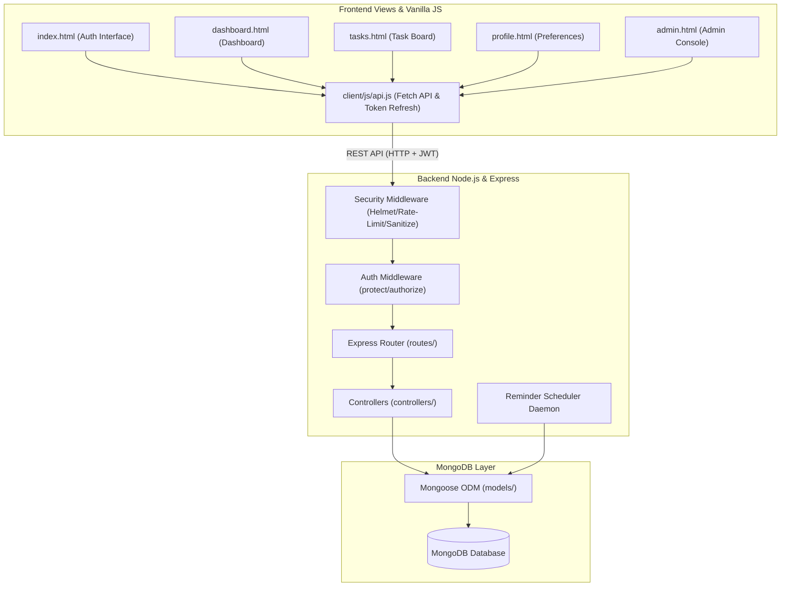
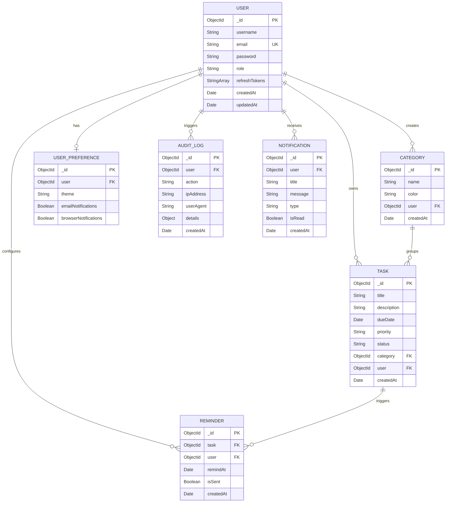
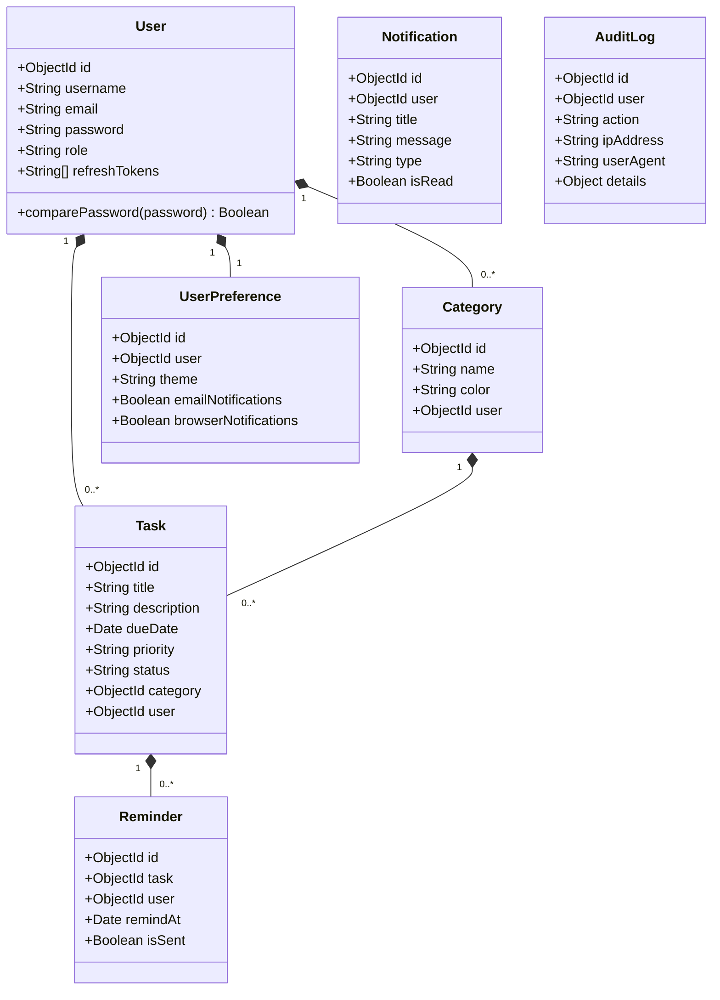
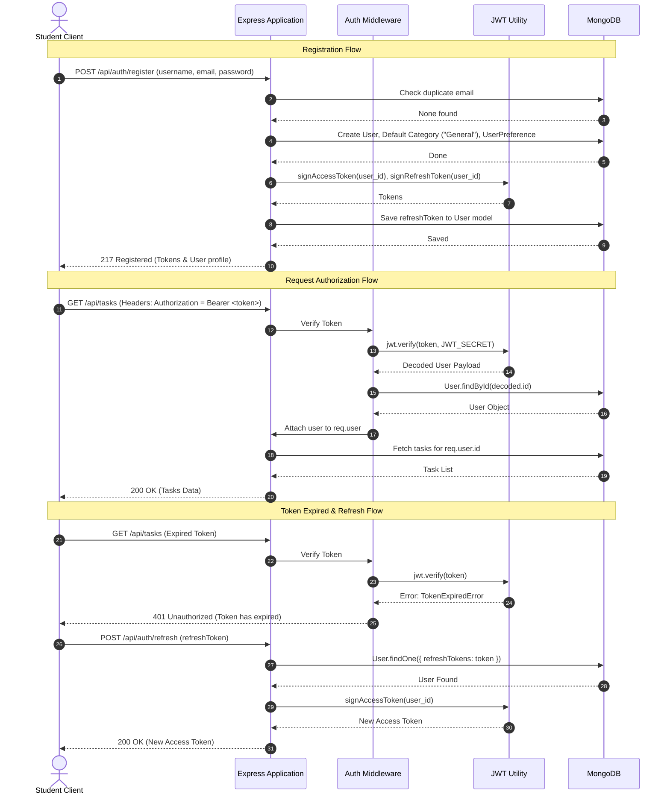
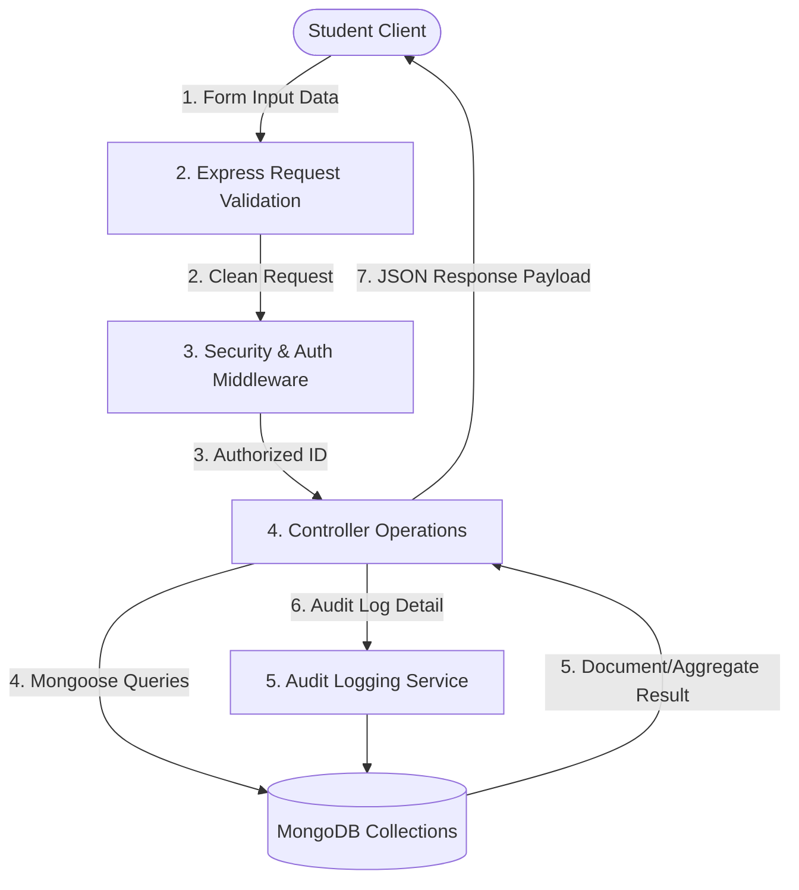
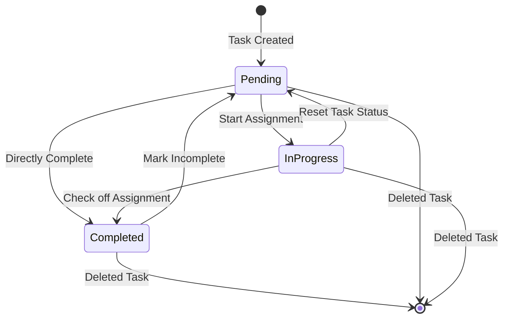

# Student Task & Assignment Tracker - System Architecture

This document describes the software architecture, design principles, database models, directory structures, and workflows implemented in the **Student Task & Assignment Tracker**.

---

## 1. System Overview & Key Features

The **Student Task & Assignment Tracker** is a premium, secure, and responsive web application designed for students and administrators to manage tasks, assignments, deadlines, categories, reminders, and user notifications.

*   **Role-Based Access Control (RBAC):** Restricts access to standard features for `student` users, and provides user management, audit logs, and global system statistics for `admin` users.
*   **Secure API Design:** Built with Node.js, Express.js, and MongoDB, protected by JWT access and refresh tokens, bcrypt password hashing, CORS, Helmet headers, express-rate-limit, and mongo-sanitize inputs.
*   **Responsive Dashboard:** Visualizes completion analytics using Chart.js, featuring list cards for upcoming deadlines, custom categories, filters, search, sorting, and pagination.
*   **Automatic Scheduler:** Background daemon scans for tasks nearing their deadlines and dispatches notifications.

---

## 2. System Architecture

The application is structured following the **Model-View-Controller (MVC)** design pattern, which decouples the database layer, route management/business logic layer, and client views.



---

## 3. Database Design & Entity-Relationship (ER) Diagram

The system stores data in 7 MongoDB collections with strict schema validations and indexing.

### Entity-Relationship Diagram



---

## 4. Class Diagram & Core Models

The class design revolves around Mongoose schemas mapped to Node controller operations.



---

## 5. Sequence Diagram: Authentication Flow

This diagram illustrates standard registration/login processes, middleware token authorization, and token refreshes.



---

## 6. System Activity & Data Flows

### Data Flow Diagram (DFD Level 1)



### Task Life-Cycle Activity Diagram



---

## 7. Folder Structure & MVC Architecture

The codebase has a clean layout following modularity patterns:

```
student-task-tracker/
├── client/                     # Frontend Static Web Server Files
│   ├── css/
│   │   └── style.css           # Premium Glassmorphic design styles
│   ├── js/
│   │   ├── api.js              # Fetch client wrapper & automated refresh
│   │   ├── auth.js             # Route protections & login/signup handlers
│   │   ├── dashboard.js        # Chart.js statistics & deadline cards
│   │   ├── tasks.js            # Task CRUD, Categories board, filters, bulk
│   │   └── admin.js            # Admin user logs and global statistics
│   ├── index.html              # Landing, Login, Signup & Recover Forms
│   ├── dashboard.html          # Analytics Dashboard
│   ├── tasks.html              # Task & Category Management Console
│   ├── profile.html            # User Settings & Preferences
│   └── admin.html              # Admin portal
├── database/
│   └── seed.js                 # Sample database seed script
├── docs/
│   ├── API_DOCUMENTATION.md    # API schema documentation
│   ├── ARCHITECTURE.md         # Architecture flows & diagrams
│   └── TESTING_REPORT.md       # Quality testing & automated run report
├── server/                     # Express.js REST Engine
│   ├── config/
│   │   └── db.js               # MongoDB connection wrapper
│   ├── controllers/
│   │   ├── authController.js   # Registration, logins, profiles, prefs
│   │   ├── taskController.js   # Tasks CRUD, pagination, bulk operations
│   │   ├── categoryController.js # Category CRUD
│   │   ├── reminderController.js # Reminder configurations
│   │   ├── notificationController.js # User notifications
│   │   ├── analyticsController.js # Summary & aggregation pipeline endpoints
│   │   ├── adminController.js  # Global system states, user records
│   │   └── auditController.js  # Security logs, login logs retrieval
│   ├── middleware/
│   │   ├── authMiddleware.js   # Protect routes & RBAC role control
│   │   ├── errorMiddleware.js  # Global Express central error handling
│   │   ├── rateLimiter.js      # Endpoint DDoS and brute force protection
│   │   └── sanitize.js         # XSS html protection & MongoDB injection
│   ├── models/                 # Database Schemas
│   │   ├── User.js
│   │   ├── Category.js
│   │   ├── Task.js
│   │   ├── Notification.js
│   │   ├── Reminder.js
│   │   ├── UserPreference.js
│   │   └── AuditLog.js
│   ├── routes/                 # Express Route Declarations
│   ├── services/
│   │   └── reminderScheduler.js # Automatic Background Deadline Scanner
│   ├── utils/
│   │   ├── appError.js         # Custom extendable Error class
│   │   ├── auditLogger.js      # Global AuditLog storage system helper
│   │   ├── jwt.js              # Access and Refresh sign utility
│   │   └── logger.js           # File and console logger helper
│   └── server.js               # Entry point configuration file
├── tests/                      # Automated Test Suite
│   ├── testSetup.js            # Environment settings and mock hooks
│   ├── mongooseMock.js         # Database-free Mongoose simulation engine
│   ├── auth.test.js            # Authentication endpoints test suite
│   └── task.test.js            # Tasks CRUD, Category & Bulk operations
├── Dockerfile                  # Server Docker Image Specification
├── docker-compose.yml          # Local container composition configuration
├── package.json                # Project script registry and dependencies
└── .env.example                # Sample environment configuration template
```

---

## 8. Deployment Guide

### Prerequisites
*   Node.js (v18+) and npm
*   MongoDB Instance (local or Atlas cluster) OR Docker Installed

### Option A: Local Deployment (Manual)
1.  **Clone code** and change to root directory.
2.  **Install dependencies:**
    ```bash
    npm install
    ```
3.  **Setup environment variables:**
    Copy `.env.example` to `.env` and fill out variables:
    ```ini
    PORT=5000
    MONGO_URI=mongodb://localhost:27017/student-task-tracker
    JWT_SECRET=your_32_character_long_secret_key_string
    JWT_REFRESH_SECRET=your_64_character_long_secret_key_string
    JWT_ACCESS_EXPIRE=15m
    JWT_REFRESH_EXPIRE=7d
    ```
4.  **Seed database with dummy data (optional):**
    ```bash
    npm run seed
    ```
5.  **Run backend dev server:**
    ```bash
    npm run dev
    ```
6.  **Open frontend:**
    Serve the `/client` directory with any static server or open `client/index.html` directly in a browser.

### Option B: Docker Container Deployment (Automated)
Build and spin up the backend and a local MongoDB instance automatically:
```bash
docker-compose up --build
```
This binds the API server to `http://localhost:5000` and configures hot-reload folders.

---

## 9. Troubleshooting & Maintenance

### 1. Issue: "JWT Secret must be defined"
*   **Cause:** The application failed to load `.env` variables.
*   **Resolution:** Verify that a `.env` file exists in the project root directory (not `server/` or `client/`) and has variables defined properly.

### 2. Issue: Mock Database Resetting in Jest Tests
*   **Detail:** Jest runs suites in isolation.
*   **Design Choice:** `mongooseMock.js` contains a state reset handler (`mongoose.clearDbStore()`) running `beforeEach` to guarantee data isolation between test cases. This is intentional.

### 3. Issue: Database Connection Failures
*   **Cause:** MongoDB is not running or network firewalls block port `27017`.
*   **Resolution:** Run `mongod` locally or configure the connection string to point to MongoDB Atlas.

---

## 10. Future Enhancements

*   **Google Calendar API Integration:** Sync task deadlines directly to Google Calendars.
*   **Collaborative Tasks:** Allow students to share categories and assign group tasks.
*   **Real-time Push Notifications:** Integrate Socket.io for immediate alerts while the browser is open.
*   **Interactive Attachment Uploads:** Enable students to attach PDFs or images to assignment tasks.
